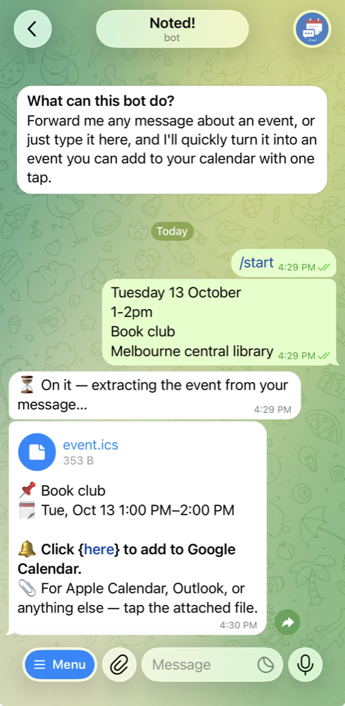

# Noted

A Telegram bot that turns a message about an event into a calendar event.
Forward it a post ("Game night, Saturday 26 Sep, 6–9:30pm, Notting Hill
Neighbourhood House"), and it replies with a one-tap Google Calendar link and
an `.ics` file for any other calendar app.

**Built on an [LLM orchestration layer](docs/ORCHESTRATION.md):** failover
across 9 free models from 2 providers, and escalation of unsure answers to
stronger models, while our code, not the model, decides every step and does
all date math.

Try it: [@noted_it_bot](https://t.me/noted_it_bot) (English) or
[@noted_it_fa_bot](https://t.me/noted_it_fa_bot) (Persian).

## What it does

- Reads events in any language, from text or a photo's caption.
- Handles what real messages leave out: a missing year, other calendars
  (Solar Hijri, Hebrew, …), "tonight" or "next Friday", a time with no date,
  and no time zone.
- Understands repeats ("every Thursday", "first Friday of the month").
- Replies in 16 languages. One code base runs two bots: English and Persian.

## How it works

- **Cloudflare Workers and D1**, called by Telegram's webhook. No server.
- **Free LLM models** (Gemini, then Groq) only *read* the message. Our code
  does all date math, so a model never invents a date. When a light model is
  unsure, a stronger one is asked again
  ([ORCHESTRATION.md](docs/ORCHESTRATION.md)).
- **Pure rules in the middle, input and output at the edges:** dates, time
  zones, repeats and the quota are pure functions, tested offline (550+
  tests). Live tests run real messages through the real models.
- A model router moves to the next free model when one hits its limit, and a
  daily quota per user protects the shared free capacity.

## Security

- **No secrets in the repo or its history.** Bot tokens and API keys live in
  GitHub Environments and Cloudflare. The full history was scanned with
  [gitleaks](https://github.com/gitleaks/gitleaks): no leaks.
- **Webhook:** every request must carry Telegram's secret token (checked in
  constant time); a wrong one gets 401.
- **The `/tz` page** knows the user only from a short-lived HMAC-signed token,
  never from what the browser sends.
- **Pull requests from forks** run without secrets.

## Docs

| Doc | What is in it |
|---|---|
| [ORCHESTRATION.md](docs/ORCHESTRATION.md) | How the bot uses LLMs: failover, escalation, and why not an agent |
| [PRODUCT.md](docs/PRODUCT.md) | Features, commands, and the backlog |
| [EDGE_CASES.md](docs/EDGE_CASES.md) | The rules for dates, calendars, repeats and time zones, and the real messages behind them |
| [ARCHITECTURE_DECISIONS_REGISTRY.md](docs/ARCHITECTURE_DECISIONS_REGISTRY.md) | Why the main parts work the way they do |
| [CODE_STRUCTURE.md](docs/CODE_STRUCTURE.md) | How the code is organised, and the coding rules |
| [DEVELOPMENT.md](docs/DEVELOPMENT.md) | Setup, tests, CI/CD, deployment and logs |
| [UBIQUITOUS_LANGUAGE.md](docs/UBIQUITOUS_LANGUAGE.md) | The words we use in code and docs |
| [CHANGELOG.md](CHANGELOG.md) | What changed in each version |

## License

[MIT](LICENSE)
